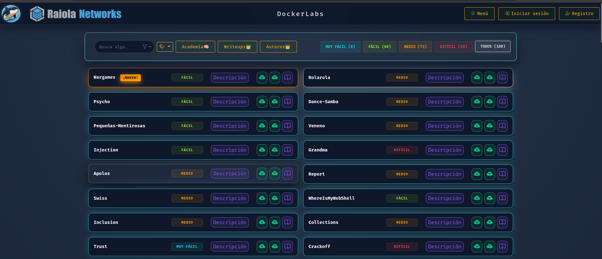
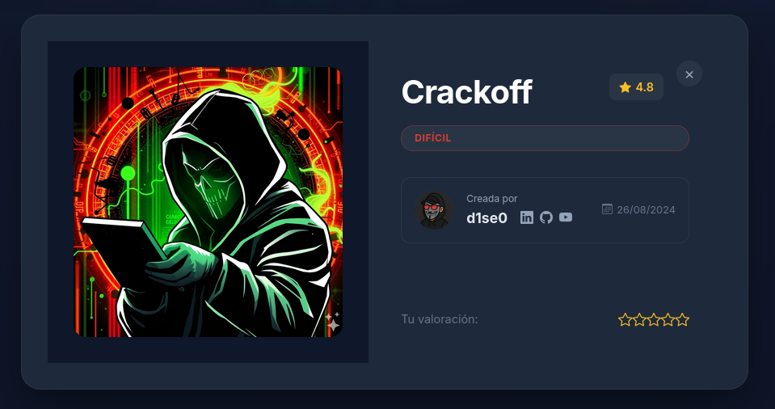
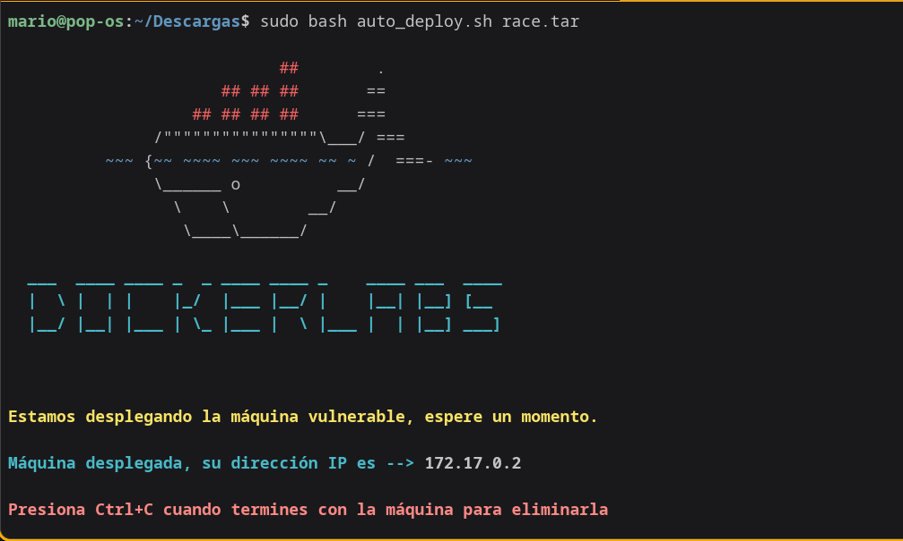

<div align="center">
  

  # DockerLabs
  
  **La Plataforma Definitiva para Entrenar tus Habilidades de Hacking Ético**

  [](CHANGELOG.md)
  [](https://github.com/Maalfer/dockerlabs/stargazers)
  [](https://github.com/Maalfer/dockerlabs/network/members)
  [](https://www.python.org/)
  [](https://fastapi.tiangolo.com/)
  [](https://www.docker.com/)

  <br>

  <p align="center">
    <strong>DockerLabs</strong> facilita el despliegue de laboratorios vulnerables en segundos usando el poder de los contenedores Docker. <br>
    Ligero, rápido y diseñado para la comunidad.
  </p>
</div>

---

## 🚀 ¿Qué es DockerLabs?

DockerLabs es una plataforma web open-source que permite a los usuarios **desplegar, practicar y aprender** ciberseguridad sin las complicaciones de configurar máquinas virtuales pesadas. Con un solo clic, puedes lanzar entornos vulnerables aislados, listos para ser explotados.

Olvídate de descargas de 4GB. DockerLabs levanta máquinas en milisegundos.

---

## ✨ Características Principales

| 🐳 **Eficiencia Docker** | 🎯 **Máquinas Variadas** | 🤝 **Comunidad** |
| :--- | :--- | :--- |
| Entornos ultraligeros que consumen recursos mínimos. Levanta 10 laboratorios donde antes solo cabía una VM. | Desde máquinas *Very Easy* hasta retos *Hard*. Filtra por dificultad, fecha, creador y mucho más. | Sube tus propios **Writeups**, valora las máquinas y compite en el ranking global. |

<div align="center">
  
  <p><em>Interfaz moderna para la gestión de máquinas y writeups</em></p>
</div>

---

## 🛠️ Tecnologías

Un stack robusto y moderno para garantizar rendimiento y escalabilidad.

<div align="center">
  
  
  
  
  
  
</div>

---

## 🔖 Versionado

DockerLabs sigue [Versionado Semántico](https://semver.org/lang/es/)
(`MAJOR.MINOR.PATCH`) a partir de la `v2.0.0`. Cada release queda
etiquetada en git y documentada en [`CHANGELOG.md`](CHANGELOG.md).

La versión desplegada se puede consultar en tres sitios, siempre
consistentes entre sí porque leen del mismo fichero [`VERSION`](VERSION):

- El pie de página de https://dockerlabs.es
- La etiqueta `<meta name="application-version">` del `<head>`
- El endpoint público `GET /api/version` → `{"version": "2.0.1"}`

Este versionado permite, además, referenciar rangos de versiones
afectadas/corregidas en los avisos de seguridad (ver
[`SECURITY.md`](SECURITY.md)) y solicitar identificadores **CVE** para
vulnerabilidades confirmadas.

---

## 💻 Instalación manual (sin Docker)

Si prefieres no depender de Docker, necesitas Python 3.13 y una base de
datos MariaDB/MySQL accesible.

1.  **Clona el repositorio:**
    ```bash
    git clone https://github.com/Maalfer/dockerlabs.git
    cd dockerlabs
    ```

2.  **Entorno virtual y dependencias:**
    ```bash
    python3 -m venv venv
    source venv/bin/activate
    pip install -r requirements.txt
    ```

3.  **Configura el entorno:** copia `.env.example` a `.env` y rellena al
    menos `DATABASE_URL` (tu MariaDB) y `SECRET_KEY`.

4.  **Arranca la app:**
    ```bash
    python3 run.py        # desarrollo: puerto 5000, con autorecarga
    # o, en modo más parecido a producción:
    venv/bin/uvicorn asgi:app --host 0.0.0.0 --port 8000
    ```
    El esquema de la base de datos se crea solo en el primer arranque.

> [!TIP]
> Si quieres la vía más rápida y reproducible (sin instalar Python ni
> MariaDB a mano), usa **Docker Compose** — sección más abajo.

<div align="center">
  
</div>

---

## ⚙️ Producción y tareas de administración

En producción, DockerLabs corre detrás de un reverse proxy (nginx o
Apache) con TLS, con la app servida vía `uvicorn` gestionado por systemd
y MariaDB como base de datos — el mismo proceso que arranca el paso 4 de
arriba, solo que supervisado por el sistema en vez de a mano.

### Rate Limiting (Cloudflare)

El sistema de limitación de peticiones (Rate Limit) está configurado para funcionar con **Cloudflare**, proporcionando protección a nivel de red sin necesidad de servicios adicionales como memcached.

### Convertir un usuario en admin

Regístrate normalmente desde la web y, con acceso a la base de datos:

```bash
mysql -u <usuario> -p dockerlabs \
  -e "UPDATE users SET role='admin' WHERE username='TU_USUARIO';"
```

(con Docker Compose, el comando equivalente está en esa sección, más abajo).

---

## 🐳 Despliegue con Docker Compose (recomendado)

La forma más rápida de levantar DockerLabs, en local o en tu propio
servidor: un solo comando levanta la app y su base de datos MariaDB.

1.  **Clona el repositorio y copia la configuración:**
    ```bash
    git clone https://github.com/Maalfer/dockerlabs.git
    cd dockerlabs
    cp .env.example .env
    ```

2.  **Edita `.env`**: como mínimo cambia `DB_PASSWORD`, `DB_ROOT_PASSWORD`
    y `SECRET_KEY` (genera esta última con
    `python3 -c "import secrets; print(secrets.token_hex(32))"`). El resto
    (SMTP, Discord) es opcional — sin SMTP configurado el registro de
    usuarios funciona igual, solo sin verificación por email.

3.  **Levanta los contenedores:**
    ```bash
    docker compose up -d --build
    ```
    La primera vez crea el esquema de la base de datos automáticamente.
    La app queda disponible en `http://localhost:8000` (o el puerto que
    hayas puesto en `APP_PORT`).

4.  **Conviértete en admin** (regístrate primero desde la web con tu
    usuario, luego):
    ```bash
    docker compose exec db mariadb -u dockerlabs -p dockerlabs \
      -e "UPDATE users SET role='admin' WHERE username='TU_USUARIO';"
    ```
    (pide la contraseña de `DB_PASSWORD` del `.env`).

Los datos (imágenes subidas y base de datos) persisten en volúmenes
Docker (`uploads_data`, `db_data`) entre reinicios. Para pararlo:
`docker compose down` (añade `-v` solo si además quieres borrar los datos).

## 👷Como contribuir en DockerLabs
En [CONTRIBUTING.md](/CONTRIBUTING.md) indicamos todos los detalles para poder contribuir en [DockerLabs](https://dockerlabs.es).

---

<div align="center">
  <h2>🌟 Historia de Estrellas</h2>
  
</div>
